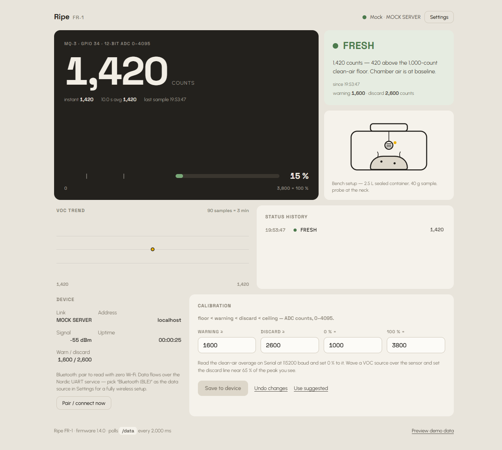

# Smart Food Spoilage Detector (ESP32 + MQ-3) — "Ripe FR‑1"

A local-only food freshness monitor: an ESP32 reads an **MQ-3** gas sensor
(alcohol / VOC vapours released by spoiling food) and serves a **Braun‑inspired
(Dieter Rams)** dashboard from its own web server. No cloud, no internet — just
open the IP on your phone.



> **Live preview:** <https://37bgxrpgalt.github.io/ripe-fr1/> — enable Pages once
> (§10), then open it with **Preview demo data** on. A hosted HTTPS page can't
> reach a local ESP32.

```
ripe-fr1/
├── README.md                          ← you are here
├── STATE.md                           ← working log: what changed, what's next
├── design.md                          ← locked style guide (Braun-inspired, one accent, dark+light tokens)
├── FIREBASE_SETUP.md                  ← optional cloud sync (Google sign-in + Firestore)
├── esp32/
│   └── food_spoilage_monitor/
│       ├── food_spoilage_monitor.ino  ← main firmware (Wi-Fi + AP + BLE + CORS)
│       ├── config.h                   ← Wi-Fi credentials & pins — LOCAL ONLY, git-ignored
│       ├── config.example.h           ← masked template (copy to config.h and fill in)
│       ├── web_page.h                 ← AUTO-GENERATED embedded dashboard
│       └── favicon_svg.h              ← AUTO-GENERATED embedded tab icon
├── web/
│   ├── index.html                     ← source of truth for the UI (has Settings + dark mode)
│   ├── firebase.js                    ← optional cloud sync — Firebase SDK, loaded on demand
│   ├── firebase-config.js             ← public Firebase web config (project ripe-fr1)
│   ├── favicon.svg                    ← tab icon (also embedded in the firmware)
│   ├── mock_server.ps1                ← local server: mock sensor + ESP32 bridge (Windows)
│   ├── mock_server.py                 ← same thing (macOS/Linux)
│   └── settings.json                  ← last-saved ESP32 address — LOCAL ONLY, git-ignored
└── tools/
    ├── embed_page.ps1                 ← regenerates web_page.h (Windows)
    └── embed_page.py                  ← same thing (macOS/Linux)
```

---

## 1. Three connectivity modes (Wi-Fi *and* BLE)

| Mode | When it's used | How to reach the dashboard |
|------|----------------|----------------------------|
| **Wi-Fi (STA)** | Default — joins your router | `http://<ESP32-IP>` shown on the Serial monitor (115200 baud) |
| **Access Point** | Router unreachable/offline — automatic after 15 s | Join Wi-Fi `FoodMonitor-XXXX` → `http://192.168.4.1` |
| **BLE UART** | Always advertised when `ENABLE_BLE 1` | nRF Connect / any BLE UART app, or the **Pair via Bluetooth** button on the page (Chrome/Edge, needs a secure context) |

The ESP32 tries your router first; if the router is down it starts its own
hotspot, so **there is always a way to check the sensor without home
internet**. BLE streams the same JSON every 2 s as a Nordic-UART service.

### BLE UART protocol
- Service `6e400001-b5a3-f393-e0a9-e50e24dcca9e`
- RX (write, phone → ESP32) `6e400002-…` · TX (notify, ESP32 → phone) `6e400003-…`
- Commands: `GET` → one JSON snapshot · `CFG:warn,spoiled,floor,ceil` → save thresholds · `PING` → `PONG`

---

## 2. Wiring

```
   MQ-3 module                    ESP32 DevKit
   ┌────────────┐
   │ VCC   AO ──┼──[10 kΩ]──┬──── GPIO 34  (ADC1, input-only)
   │ GND   DO ──┼──(unused)  │
   └────────────┘            └──[10 kΩ]── GND
        │
        ├── VCC → 5 V (VIN/external 5 V supply)
        └── GND → GND (common ground!)
```

- **Voltage divider is mandatory.** MQ-3 AO swings up to ~5 V; GPIO 34 is
  **not** 5 V tolerant. `10 k + 10 k` gives ×0.5 (AO max 5 V → 2.5 V).
  `20 k` series + `10 k` to GND gives ×0.67 if you want more resolution.
- Keep it on **ADC1** (GPIO 32–39's ADC2 half doesn't work while Wi-Fi runs).
- Power the MQ-3 from **5 V**, not a 3.3 V pin — the heater needs the current.
  An external 5 V supply is safest; a strong USB port via VIN is usually fine.

### Test-chamber workflow
1. Put the food sample (bread, fruit…) in a sealable container.
2. Mount the MQ-3 inside or right at the opening.
3. Watch the dashboard: fresh food holds a steady baseline; spoiled food
   makes the reading climb as VOCs accumulate in the headspace.

---

## 3. Flashing the firmware

1. Arduino IDE → **Tools → Board → esp32 → "ESP32 Dev Module"**.
   (No extra libraries needed — WiFi, WebServer, Preferences and BLE all
   ship with the ESP32 core.)
2. Edit `esp32/food_spoilage_monitor/config.h`:
   ```c
   #define WIFI_SSID     "YOUR_SSID"
   #define WIFI_PASSWORD "YOUR_PASSWORD"
   #define ENABLE_BLE    1     // set 0 to save RAM / boost Wi-Fi range
   ```
3. Open `food_spoilage_monitor.ino` and upload.
4. Open Serial Monitor @ **115200** — it prints the dashboard URL and then a
   `raw,avg,status` CSV stream you can graph in the Arduino Serial Plotter.

---

## 4. Calibration (do this once)

The MQ-3 needs **24–48 h of heater burn-in on first use**, then 2–5 minutes
warm-up before each measurement session.

1. Power up and watch the *Smoothed average* in clean room air → that's your
   baseline (`CAL_FLOOR` ≈ that value).
2. Set **Warning** ≈ 15–25 % above the clean-air baseline.
3. Hold a VOC source near the sensor (spoiled food, a hand-sanitiser wipe)
   and note the peak → set **Spoiled** ≈ 60–70 % of that peak.
4. Set **Bar 100%** (`CAL_CEIL`) to a strong peak so the gauge tops out.
5. Press **Save** on the dashboard — values are stored in ESP32 flash (NVS)
   and survive reboots. (Or edit the `DEF_*` values in `config.h`.)

Rule enforced in hardware and UI: `floor < warning < spoiled < ceil`.

---

## 5. Dashboard features

- **Braun‑inspired (Dieter Rams) UI** — asymmetric 6‑column bento layout. Graphite instrument display, one warm‑gray temperature, **one accent** (`#edb100`). Signal colours (green/red) only where functional (status lamp and gauge).
- **Distinct typography** — **Space Grotesk** for display/numerals/labels, **Urbanist** for UI. An alternative **Editorial** pairing (**Merriweather** + **PT Sans**) is selectable in **Settings → Appearance**. No Inter/Roboto/Poppins as defaults; system fallbacks only at the end. Google Fonts are fetched over the internet when reachable, but the ESP32 serves the page from its own AP with no internet — fonts gracefully fall back to the system stack.
- **Custom illustration** — a single bespoke SVG of the sealed test chamber (probe at the neck, rising VOCs), no icon sets, no emojis.
- **Specific, falsifiable copy (Advanced view)** — every sentence uses real numbers (counts, ms cadence, IP, RSSI, uptime). Redundant micro‑labels deleted (no “newest first”, no “overall status”). Hint copy is computed from live values: e.g. “1,702 counts — 102 past the 1,600 warning line.”
- **Basic / Advanced view** — **Settings → Dashboard** switches the page between **Advanced** (the full instrument: readout, gauge, VOC trend, history, device block, calibration) and **Basic**, which drops every ADC number and shows the verdict word plus a plain‑language sentence — *“Still fresh — safe to eat.” / “Starting to spoil — check it soon.” / “Spoiled — do not eat.”* — a **last‑sample** timestamp, a **plain status history** (status + time only) and the chamber illustration. For people who don't read counts. Stored in `localStorage` like the theme; applied before first paint so there is no flash.
- **Measurement hierarchy** — graphite readout shows raw + instant + 10.0 s moving average, 0–100 % gauge with threshold ticks. Verdict block shows the lamp + word + dynamic hint + “since HH:MM:SS”. 
- **VOC trend** sparkline (last 90 samples ≈ 3 minutes), graphite line with one amber endpoint.
- **Status history** log with timestamps (status changes). No dividers, whitespace‑based.
- **Calibration panel** — four inputs with the enforced rule `floor < warning < discard < ceiling` (0–4095), Save / Undo / Use suggested. Values persist to ESP32 NVS flash.
- **Device block** — transport, IP, RSSI, uptime, thresholds. Bluetooth action lives one level down (not in primary nav).
- **Settings** (header button) — pick the **data source** (*Mock server*, *ESP32 (Wi‑Fi)* or *Bluetooth (BLE)*), the ESP32 host/IP + port, the route (*Via local server* proxy vs *Direct from browser*), the **poll interval** (1/2/5 s), the **dashboard mode** (*Basic* / *Advanced*), the **theme** and the **typeface** (Grotesk / Editorial). Stored in `localStorage`, never on the device.
- **Optional cloud sync (Firebase)** — sign in with Google under **Settings → Account**, then pick **Cloud sync**: *Publish this device* mirrors this device's readings to `users/{uid}/state/latest` (plus a history doc per status change), or *Follow the cloud* renders another device's readings from anywhere. The household shares one Google account. Signed-in devices also share the **look & feel** — theme, typeface, Basic/Advanced and poll interval live in `users/{uid}/prefs/main`, so changing the theme on one device updates the others (the data source and ESP32 address stay per-device). The Firebase SDK is loaded **on demand**, so the ESP32's offline page never touches it. Setup: [`FIREBASE_SETUP.md`](FIREBASE_SETUP.md).
- **Dark & light mode** — the same Braun palette with a warm near-black surface ladder; the graphite readout stays dark in both. Chosen in **Settings → Appearance**: Light / Dark / System (follows the OS).
- Polls `GET /data` **every 2 s** (configurable), updates in place, never reloads.
- Graceful failure: 1–3 failed polls → amber *Reconnecting…*; 4+ → red *Disconnected*, keeps last known values visible (dimmed).
- **Preview demo** link in the footer to preview the full UI with zero hardware. See [`design.md`](design.md) for the complete locked style guide.

---

## 6. API

| Endpoint | Method | Response |
|----------|--------|----------|
| `/` | GET | the dashboard (embedded, no external assets) |
| `/favicon.svg` | GET | the tab icon (`image/svg+xml`, embedded from `web/favicon.svg`) — also served at `/favicon.ico` |
| `/data` | GET | `{"value":1450,"raw":1450,"avg":1438,"pct":16,"status":"FRESH","thr_warn":1600,"thr_spoiled":2600,"cal_floor":1000,"cal_ceil":3800,"uptime_s":312,"rssi":-54,"mode":"WI-FI + BLE","ip":"192.168.1.57"}` |
| `/config` | POST | body `{"warn":1600,"spoiled":2600,"floor":1000,"ceil":3800}` → `{"ok":true}` or `400 {"ok":false,"error":"…"}` |
| `/server-info` | GET | *local server only* — `{"mode":"mock","esp32Host":"192.168.1.57","esp32Port":80,"server":"python","port":8010}` |
| `/settings` | GET | *local server only* — last-saved ESP32 address: `{"ok":true,"host":"192.168.1.57","port":80}` (empty host until one is saved) |
| `/settings` | POST | *local server only* — body `{"host":"192.168.1.57","port":80}` → saved to `web/settings.json` next to the server, so the address survives a cleared or new browser |
| `/proxy/data?host=&port=` | GET | *local server only* — reads `<host>:<port>/data` on the real ESP32 (no CORS) |
| `/proxy/config?host=&port=` | POST | *local server only* — forwards the body to `<host>:<port>/config` |

The `web/settings.json` file is created the first time you press **Save & connect**;
delete it to forget the address. The ESP32 also answers `OPTIONS` and sends
`Access-Control-Allow-Origin: *`, so the dashboard can poll it **directly** from
a browser (Settings → ESP32 → *Direct from browser*).

---

## 7. Running the UI — mock sensor **or** a real ESP32

The local server is both a mock sensor and a bridge to real hardware. Start
it, open the page, then pick the source in **Settings → Data source**.

**Windows (no installs needed):**
```powershell
powershell -ExecutionPolicy Bypass -File web\mock_server.ps1
# open http://localhost:8000
```

**macOS / Linux / Windows with Python:**
```bash
python web/mock_server.py
# open http://localhost:8000
```

### Option A — Mock server (default, no hardware)
The server simulates the MQ-3 (random walk + periodic spoilage events) and
implements `/data` + `/config` with the exact JSON contract of the firmware.
Leave *Data source* on **Mock server**.

### Option B — Real ESP32
Start the server pointed at the device (pre-fills the Settings panel):
```powershell
powershell -ExecutionPolicy Bypass -File web\mock_server.ps1 -Esp32Host 192.168.1.57
#   or:  python web/mock_server.py --esp32 192.168.1.57
#   or:  python web/mock_server.py --mode esp32 --esp32 192.168.1.57   # boot straight into ESP32
```
Then **Settings → Data source → ESP32 device → Test connection → Save & connect**.
The address you Save is also written to `web/settings.json`, so a fresh browser
(or a cleared `localStorage`) picks it up automatically on first load.

- **Via local server** (default) — the browser calls `/proxy/data` on the local
  server, which forwards to the ESP32. No CORS, works over plain HTTP. Use this.
- **Direct from browser** — the browser calls `http://<esp32-ip>/data` itself.
  Needs the updated firmware (CORS headers, v1.4.0) and the ESP32 reachable on
  the same network.

Extra server options: `--port 8010` / `-Port 8010`, `--esp32-port 80`,
env `ESP32_HOST`, `MODE`. (`--mode esp32` makes `/data` itself live.)

> Windows note: if port 8000 is blocked (`WinError 10013`), pass `-Port 8010` /
> `--port 8010` and open `http://localhost:8010`.

---

## 8. Updating the embedded page

`web/index.html` is the single source of truth. After editing it, regenerate
the firmware copy:

```bash
powershell -File tools\embed_page.ps1     # Windows
python tools/embed_page.py                # macOS / Linux
```

Then reflash. (In `web_page.h` the HTML lives in a C++ raw string — the
scripts warn you if the file contains the string terminator.)

---

## 9. Troubleshooting

| Symptom | Fix |
|---|---|
| Random readings / never above baseline | Missing voltage divider — remove it before it damages GPIO 34 |
| Values freeze when Wi-Fi connects | Sensor on an ADC2 pin — move to GPIO 34 (ADC1) |
| Reading always maxed | AO wired straight to 34 (5 V on the pin) — add divider |
| Baseline drifts for hours | Normal — MQ-3 needs 24–48 h burn-in on first use |
| Page won't open | Check Serial Monitor for the IP; if in AP mode join `FoodMonitor-XXXX` first |
| Wi-Fi keeps dropping | Set `ENABLE_BLE 0` in `config.h` (radio coexistence), or move closer to the router |
| BLE button greyed out | Web Bluetooth needs Chrome/Edge on Android/desktop and a secure context (localhost/HTTPS); over plain HTTP use nRF Connect instead |

---

## 10. Hosting the dashboard (GitHub Pages)

The dashboard is plain static files, so it can also be published as a website.
Only `web/` is served — the firmware, tools and docs stay in the repo but are not
published.

**Live:** <https://37bgxrpgalt.github.io/ripe-fr1/>

### Enabling it
1. Use a **public** repo (the free Pages tier requires it).
2. Repo → **Settings → Pages → Build and deployment → Source: GitHub Actions**.
3. `.github/workflows/pages.yml` then publishes `web/` on every push to `main`;
   the URL is `https://<you>.github.io/<repo>/`.

### What works, and what doesn't
- **Everything runs** — the page is client-side JS; Pages just serves the files.
- **"Preview demo data"** works with no backend at all, and the Google Fonts load
  normally (a hosted page has internet).
- **It cannot reach the ESP32.** A page served over HTTPS is blocked by the
  browser from calling `http://192.168.1.57/data` ("mixed content"), and the ESP32
  has no TLS. The hosted page therefore follows the **cloud** (Firebase) instead;
  publishing is done by the Android app or the local `http://localhost:8012`
  page. See `FIREBASE_SETUP.md`.
- The ESP32's own page and the local server page are unaffected.

### Secrets
`esp32/food_spoilage_monitor/config.h` (Wi-Fi SSID/password) is **git-ignored**;
the committed `config.example.h` is a masked template — copy it to `config.h` and
fill in your own values.
